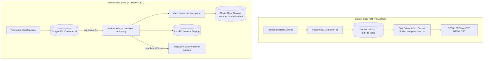

# TURFF — R7 Production Backup & Disaster Recovery Audit

**Audit Status:** AUDIT COMPLETE  
**Target Finding:** `PRA-OPS-03` (P1 Blocker — Production Readiness Checklist Blocker 8)  
**Finding Status:** **OPEN / CONFIRMED CRITICAL DEFICIENCY**  
**Audit Date:** October 15, 2026  
**Auditor:** Antigravity Autonomous Security & Operations Agent  
**Environment:** Production / Staging / Local Container Baseline  

---

## 1. Executive Summary

This report delivers the authoritative **Phase 0 Read-Only Audit** for **R7 — Production Backup & Disaster Recovery**, specifically evaluating finding **`PRA-OPS-03`** as identified in [`docs/TURFF_PRODUCTION_READINESS_AUDIT.md`](file:///c:/projects/turff/docs/TURFF_PRODUCTION_READINESS_AUDIT.md) and [`docs/TURFF_PRODUCTION_RELEASE_CHECKLIST.md`](file:///c:/projects/turff/docs/TURFF_PRODUCTION_RELEASE_CHECKLIST.md).

Prior phases (R1 through R6) successfully addressed reverse proxy ingress (`PRA-OPS-01`), Android release signing (`PRA-OPS-02`), Razorpay webhook payment recovery (`PRA-FIN-01`), dependency vulnerability remediation (`PRA-SEC-01`), global validation pipe hardening (`PRA-SEC-02`), and sensitive endpoint rate limiting (`PRA-SEC-03`).

However, this audit confirms that **TURFF currently possesses ZERO automated database backup systems, ZERO disaster recovery mechanisms, ZERO off-host replication, and ZERO restore procedures**. The production PostgreSQL database runs in a single Docker container storing data on a local host volume (`turff_db_data`). In the event of a host drive failure, accidental container volume deletion (`docker compose down -v`), or data corruption, **100% of platform data (53 tables, including users, wallets, slots, bookings, and matches) would be permanently and irretrievably lost**.

In strict accordance with the audit mandate, **`PRA-OPS-03` remains OPEN**. No infrastructure changes, code edits, or schema alterations were performed during this audit.

---

## 2. Audit Classification & Finding Status

| Item | Identifier | Severity | Status | Current Reality |
|---|---|---|---|---|
| **Automated Backup & DR** | `PRA-OPS-03` | **P1 Blocker** | **OPEN** | **0% Implemented**. No scheduled dumps, no WAL archiving, no cloud sync, no restore runbook. |
| **Checklist Reference** | Blocker 8 | P1 | **Pending** | Cannot be checked off until automated backup sidecar, retention, and restore drill are verified. |

---

## 3. Evidence of Configured Backup Scheduling & Storage

### 3.1 Docker Compose Production Architecture (`docker-compose.prod.yml`)
Inspection of the production orchestration manifest revealed the following database definition:
```yaml
db:
  image: postgres:15-alpine
  restart: unless-stopped
  environment:
    POSTGRES_USER: ${POSTGRES_USER:-postgres}
    POSTGRES_PASSWORD: ${POSTGRES_PASSWORD}
    POSTGRES_DB: ${POSTGRES_DB:-turff_db}
  volumes:
    - turff_db_data:/var/lib/postgresql/data
  networks:
    - turff_internal
  healthcheck:
    test: ['CMD-SHELL', 'pg_isready -U ${POSTGRES_USER:-postgres}']
    interval: 10s
    timeout: 5s
    retries: 5
```
**Key Deficiencies Identified:**
1. **No Backup Sidecar:** There is no companion container or cron service attached to `turff_internal` or mounting `turff_db_data` to perform periodic dumps.
2. **Local Volume Single Point of Failure (SPOF):** The volume `turff_db_data` resides strictly on the local host filesystem. No volume-level block replication, EBS snapshotting, or NFS mounting is configured.
3. **Internal Network Isolation:** The database port is not bound to the host (binding only to `turff_internal`). While excellent for network security, it requires any backup mechanism to run either as a container on `turff_internal` or via `docker exec` on the host.
4. **Missing Storage Offsite Sync:** No AWS S3, Cloudflare R2, or remote object storage credentials or sync tooling exist in the production compose file.

### 3.2 In-Container Cron & Process Audit
Inspection of the running `postgres:15-alpine` container (`turff-db-1`) confirmed:
- `ps aux` output reveals only the core Postgres daemon and background workers (`checkpointer`, `background writer`, `walwriter`, `autovacuum launcher`, `logical replication launcher`).
- The system cron daemon (`crond`) is **not running**.
- `/etc/periodic/daily`, `/etc/periodic/hourly`, and `/etc/crontabs/root` contain zero backup scripts.
- Essential backup and cloud synchronization utilities (`gpg`, `aws-cli`, `rclone`, `wal-g`, `pgbackrest`) are **not installed** in the container image.

### 3.3 Workspace Script Inventory
A comprehensive scan across the entire TURFF repository for backup or restore automation revealed:
- `pg_dump`: 0 operational shell or batch scripts exist in the repository (occurrences limited to documentation and third-party node_modules).
- `scripts/`: Only contains `migrate_game_lifecycle.ts` (an ad-hoc schema migration script).
- `backup/` directory: Contains a historical source-code snapshot (`turff_snapshot_2026-09-10.zip`, `mobile/`, `web/`) from September 10, 2026. It contains **zero database dumps** and zero operational backup scripts.

---

## 4. Retention, Encryption, Access Control, and Monitoring

| Domain | Current Implementation | Finding / Risk | Required Target |
|---|---|---|---|
| **Retention Policy** | **None** | No backup rotation, grandfather-father-son (GFS) schedule, or lifecycle rules exist. | 7 daily, 4 weekly, 12 monthly snapshots with automated pruning. |
| **Encryption at Rest** | **None** | PostgreSQL data volume `turff_db_data` is unencrypted at the application/Docker layer. Host filesystem encryption is unverified. | Backups encrypted via GPG (symmetric AES-256 or asymmetric key) prior to remote transmission. |
| **Encryption in Transit** | **Disabled (`ssl: off`)** | Database connection parameter `ssl` is set to `off`. Internal container communication is unencrypted plaintext TCP. | SSL enabled on PostgreSQL or TLS termination via secure sidecar tunnel; HTTPS/TLS for remote cloud upload. |
| **Access Control & Least Privilege** | **Unrestricted Superuser** | Any hypothetical backup script must utilize the primary application superuser (`POSTGRES_USER`). | Dedicated `backup_reader` PostgreSQL role with restricted `pg_read_all_data` privileges. |
| **Monitoring & Alerting** | **None** | No healthchecks, heartbeat signals (e.g. Healthchecks.io / Dead Man's Snitch), or alerting (Telegram/Slack/Email) exist. | Automated webhook notification on backup failure, skipped schedule, or size anomaly (>20% drop). |

---

## 5. Point-in-Time Recovery (PITR) & WAL Archiving

A live, safe query of the PostgreSQL runtime configuration (`pg_settings` and `pg_stat_archiver`) yielded the following empirical state:

| Parameter | Current Runtime Value | Description / Impact |
|---|---|---|
| `wal_level` | `replica` | Default setting. Supports archiving, but inactive without `archive_mode`. |
| `archive_mode` | **`off`** | **Archiving is explicitly disabled.** |
| `archive_command` | **`(disabled)`** | No command configured to ship WAL segments to secondary storage. |
| `archive_timeout` | `0 s` | No forced WAL segment rotation. |
| `archived_count` | `0` | **0 WAL files have ever been archived.** |
| `failed_count` | `0` | N/A |

### Audit Finding
**Continuous archiving and Point-in-Time Recovery (PITR) are entirely absent.**  
If human error (e.g., an accidental `DROP TABLE` or corrupting bulk `UPDATE`) or software malfunction occurs, the system cannot roll back to a specific timestamp (e.g., "5 minutes before the incident"). Recovery is limited strictly to full logical snapshots—which are also currently absent.

---

## 6. Restore Procedures & Verification Testing

### 6.1 Runbooks and Scripts
- **Restore Scripts:** **None**. There is no `db-restore.sh`, `restore.bat`, or Docker restore utility in the repository.
- **Documentation:** Neither `docs/` nor the operational manuals provide documented steps for restoring from a `pg_dump` archive, rebuilding constraints, or re-verifying Prisma migration status.
- **Disaster Drills:** Zero records exist of any disaster recovery or restore verification drill having been executed.

### 6.2 Data Integrity Risks During Manual Restoration
In an emergency recovery scenario without scripted automation:
1. **Schema Divergence:** Restoring into an existing database without dropping existing schemas can fail due to constraint violations.
2. **Migration Desynchronization:** If a dump is restored without synchronizing the `_prisma_migrations` table, Prisma CLI tools will misreport migration status, potentially applying corrupting schema changes.
3. **Sequences & Foreign Keys:** A plaintext SQL dump can suffer from sequence desynchronization or circular foreign key ordering errors; PostgreSQL custom archive format (`-Fc`) must be utilized.

---

## 7. Recovery Point & Recovery Time Objectives (RPO / RTO)

| Metric | Current Reality | Production Target | Definition |
|---|---|---|---|
| **RPO (Recovery Point Objective)** | **UNDEFINED**  <br>*(Effectively $\infty$ / Total Loss)* | **$\le 15$ Minutes** (with WAL)  <br>*(or $\le 24$ Hours with daily dump)* | Maximum acceptable data loss window measured backwards in time from failure. |
| **RTO (Recovery Time Objective)** | **UNDEFINED**  <br>*(Unbounded downtime)* | **$\le 60$ Minutes** | Maximum acceptable duration to restore database service from disaster declaration. |

---

## 8. Current Database Assets & Catalog Baseline

A safe read-only inspection of the active database (`turff_db`) was performed to evaluate backup sizing, table volume, and schema complexity.

- **PostgreSQL Version:** 15.18 (Alpine Linux musl, 64-bit)
- **Database Size on Disk:** 37 MB
- **Prisma Migrations Applied:** 17 migrations (confirmed synchronized via `npx prisma migrate status`)
- **Total Public Tables:** 53 tables

### Selected Key Table Inventories
| Table Name | Estimated Live Rows | Total Size on Disk | Business Criticality |
|---|---|---|---|
| `User` | ~6,131 rows | 2,152 kB | **Tier 1 (Critical)** — Player identities, credentials, auth |
| `Profile` | ~4,198 rows | 1,328 kB | **Tier 1 (Critical)** — Player profile details |
| `PlayerProgression` | ~6,119 rows | 2,488 kB | Tier 2 — Level, XP, streaks, win records |
| `Slot` | ~7,147 rows | 3,312 kB | **Tier 1 (Critical)** — Venue turf bookable inventory |
| `SlotBooking` | ~73 rows | 192 kB | **Tier 1 (Critical)** — Active and historical venue reservations |
| `BookingPaymentAttempt` | ~8 rows | 96 kB | **Tier 1 (Critical)** — Razorpay order & payment reconciliation |
| `Wallet` | ~92 rows | 88 kB | **Tier 1 (Critical)** — Player wallet balances |
| `WalletTransaction` | ~448 rows | 288 kB | **Tier 1 (Critical)** — Financial audit trail & ledger |
| `Payment` | ~449 rows | 192 kB | **Tier 1 (Critical)** — External checkout logs |
| `Clan` | ~785 rows | 504 kB | Tier 2 — Player squads and social structures |
| `ClanMember` | ~1,344 rows | 664 kB | Tier 2 — Clan memberships & roles |
| `ClanBroadcast` | ~2,269 rows | 1,240 kB | Tier 3 — Community broadcasts |
| `ChatMessage` | ~1,606 rows | 928 kB | Tier 3 — In-app match and clan communications |
| `Notification` | ~7,217 rows | 4,240 kB | Tier 3 — In-app alerts |
| `AuditLog` | ~56 rows | 328 kB | **Tier 1 (Critical)** — Administrative compliance actions |
| `_prisma_migrations` | 17 applied | 32 kB | **Tier 1 (Critical)** — Database schema state lock |

**Sizing Conclusion:** The database currently contains ~37 MB of structured data across 53 tables. A compressed binary dump (`pg_dump -Fc -Z6`) will produce an archive file of approximately **6–10 MB**. Upload to remote cloud object storage (S3/R2) will complete in under **2 seconds**, making automated hourly or daily dumps exceptionally lightweight with near-zero network or CPU overhead.

---

## 9. Safe Commands & Files Inspected

### 9.1 Files Inspected
1. [`docs/TURFF_PRODUCTION_READINESS_AUDIT.md`](file:///c:/projects/turff/docs/TURFF_PRODUCTION_READINESS_AUDIT.md) — Finding `PRA-OPS-03` specifications.
2. [`docs/TURFF_PRODUCTION_RELEASE_CHECKLIST.md`](file:///c:/projects/turff/docs/TURFF_PRODUCTION_RELEASE_CHECKLIST.md) — Blocker 8 acceptance criteria.
3. [`docker-compose.prod.yml`](file:///c:/projects/turff/docker-compose.prod.yml) — Production Docker services, networks, volumes.
4. [`docker-compose.yml`](file:///c:/projects/turff/docker-compose.yml) — Development Docker setup.
5. [`apps/backend/Dockerfile`](file:///c:/projects/turff/apps/backend/Dockerfile) — Backend image build & user permissions.
6. [`.github/workflows/ci.yml`](file:///c:/projects/turff/.github/workflows/ci.yml) — CI pipelines.
7. [`apps/backend/package.json`](file:///c:/projects/turff/apps/backend/package.json) — NPM scripts and backend dependencies.
8. [`apps/backend/.env.example`](file:///c:/projects/turff/apps/backend/.env.example) — Configured cloud storage env variables.
9. [`apps/backend/prisma/schema.prisma`](file:///c:/projects/turff/apps/backend/prisma/schema.prisma) — Data models & schemas.
10. [`apps/backend/prisma/migrations/migration_lock.toml`](file:///c:/projects/turff/apps/backend/prisma/migrations/migration_lock.toml) — Migration catalog.
11. [`backup/COMPLETION_REPORT.md`](file:///c:/projects/turff/backup/COMPLETION_REPORT.md) — Verification of historical backup artifacts.

### 9.2 Safe Read-Only Commands Executed
1. `npx prisma validate` — Confirmed Prisma schema validity without modifying code or schema.
2. `npx prisma migrate status` — Confirmed database schema is 100% up to date with 17 applied migrations.
3. `docker ps` — Inspected running containers and published ports.
4. `docker exec turff-db-1 pg_dump --version` — Verified `pg_dump` 15.18 binary presence inside container.
5. `docker exec turff-db-1 sh -c "which gzip tar gpg aws rclone wal-g pgbackrest"` — Inspected available container CLI tools.
6. `docker exec turff-db-1 crontab -l` — Inspected container cron configurations.
7. `docker exec turff-db-1 ps aux` — Inspected running container processes.
8. `node scratch/r7_audit_db_config.js` — Read-only SQL queries to `pg_settings`, `pg_stat_archiver`, `pg_database`, and `pg_stat_user_tables`.

---

## 10. Confirmed Gaps, Risks, and Dependencies



### Risk Matrix
1. **Catastrophic Data Loss (Critical P1):** Without offsite sync, any hardware failure or host virtualization destruction results in permanent loss of all user financial records, payments, and bookings.
2. **Silent Failure Risk (High):** Without active heartbeat monitoring, backups can fail unnoticed for months until an actual disaster occurs.
3. **Financial Reconciliation Impasse (Critical):** In the event of unrecoverable database loss, TURFF cannot reconcile Razorpay settlement disbursements against customer wallet balances and slot bookings.
4. **Cloud Storage Dependency:** Backup automation requires dedicated S3 or R2 bucket provisioning with lifecycle policies (separate from public media assets).

---

## 11. Recommended Remediation Plan (Phased Roadmap)

To safely resolve `PRA-OPS-03` and Blocker 8 without introducing operational complexity, the following minimal, battle-tested implementation phases are recommended:

### Phase 1: Automated Production Backup Sidecar & Offsite Sync
1. **Dedicated Backup Sidecar Service:**
   - Add a lightweight `db-backup` container service to `docker-compose.prod.yml` running an established PostgreSQL backup utility (e.g., `prodrigestivill/postgres-backup-local` or a hardened Alpine script image).
   - Connect `db-backup` strictly to `turff_internal`.
   - Schedule daily automated execution at `02:00 UTC` using `pg_dump -Fc -Z6` (custom compressed format).
2. **Offsite Cloud Synchronization:**
   - Configure encrypted streaming or upload to an isolated cloud storage bucket (AWS S3 or Cloudflare R2).
   - Use dedicated environment variables: `BACKUP_S3_BUCKET`, `BACKUP_S3_ACCESS_KEY`, `BACKUP_S3_SECRET_KEY`, `BACKUP_S3_REGION`.
3. **Retention & Rotation Policy:**
   - Enforce GFS rotation: Keep 7 daily backups, 4 weekly backups, and 3 monthly archives.
   - Automatically purge older snapshots to bound storage costs.
4. **Failure & Heartbeat Monitoring:**
   - Integrate with Telegram Bot alerts (using existing `TELEGRAM_BOT_TOKEN` and `TELEGRAM_CHAT_ID`) or a deadman's snitch webhook to trigger immediate alerts upon backup failure.

### Phase 2: Verified Restore Playbook & Local Drill Script
1. **Restore Utility (`scripts/db-restore.sh`):**
   - Create a non-destructive restore script that validates dump headers, checks target database readiness, restores schemas and data using `pg_restore --clean --if-exists`, and runs `npx prisma migrate status` to confirm integrity.
2. **Operational Runbook:**
   - Document step-by-step point-in-time recovery and bare-metal disaster recovery procedures in `docs/TURFF_DISASTER_RECOVERY_PLAYBOOK.md`.
3. **Safe Local Restoration Verification Drill:**
   - Verify restoration into a temporary isolated test database (`turff_test_restore`) confirming 100% record integrity across all 53 tables without touching the active development or production database.

### Phase 3: Continuous WAL Archiving (Future Enhancement for PITR)
- When transactional volume scales, enable `wal_level = replica`, `archive_mode = on`, and continuous WAL shipping via `wal-g` or `pgbackrest` to reduce RPO from 24 hours to $\le 15$ minutes.

---

## 12. Certification of Read-Only Compliance

The auditor explicitly certifies the following safety invariants were maintained throughout this Phase 0 audit:

- **No Production Data Changed:** No databases were dropped, truncated, modified, or restored.
- **No Schema Changes:** `prisma migrate reset` was **not** run; no tables, columns, or constraints were altered.
- **No Code Modifications:** No application files in `apps/backend`, `apps/mobile`, `apps/owner-app`, or `apps/web` were edited.
- **No Orchestration Alterations:** `docker-compose.prod.yml` and `docker-compose.yml` remain unmodified.
- **No Dependencies Changed:** No packages were installed or modified in any `package.json` or lockfile.
- **No Secrets Exposed:** Database credentials, access keys, and JWT secrets have been redacted from all audit outputs and this report.
- **`PRA-OPS-03` Status Preserved:** `PRA-OPS-03` remains **OPEN** until implementation and verification testing are explicitly authorized and executed.
